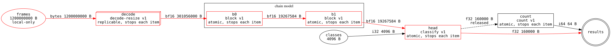

# Dashmag

**A machine-learning library in Rust, on [Burn](https://burn.dev).**

Dashmag is a general machine-learning library in Rust. Burn beneath it supplies tensors, autodiff
and devices; Dashmag adds the compute layer that applications build on, and inference. Together
they are meant to do for Rust what PyTorch does for Python.

Dashmag is two families of crates. dash is the operations, the same on every platform: the
`dash-` crates are the library, on the hardware of one machine. mag is the pathway from one
algorithm to whatever devices are there, on every platform: the `mag-` crates, just begun, are to
make one pool of the machines a person has and place work across them. Three crates make it
([below](#mag-one-pool-from-the-machines-you-have)). dash + mag = Dashmag.

The compute layer is the operations Burn does not have, in forward, backward and decoding-step
forms with kernels for Burn's backends; layers, such as LoRA; autodiff utilities, such as
activation checkpointing; and the modules training uses (losses, optimisers, learning-rate
schedules). Each is built for a family of models (transformers for language, convolutional
networks), not shaped to one, and each operation is benchmarked on its own, at the shapes its
workload gives it. Inference runs trained models, a whole model in one forward call, tensors in
and tensors out, on whatever hardware is at hand, with exits to the compilers of accelerators Burn
cannot drive. Each part is held to values recorded from the implementation it replaces (PyTorch,
torchvision, Pillow, transformers, PEFT), and each test says where its recording comes from.

What sits above both is the application's, written on top of Dashmag: modules and training code
shaped to its own model, its training loop and training algorithms (PPO, GRPO and their kind), the
generation loop that calls a model step by step, samples, keeps each sequence's state and decides
when to stop, and its task harness. For a generation loop Dashmag gives the decoding-step
operations, such as attention against a key-value cache and the gated delta rule's recurrent step.

> **Status:** pre-alpha, moving fast. APIs will change.

## What is here

| Crate | What it is | Status |
|---|---|---|
| [`dash-models`](crates/dash-models) | model architectures as Burn modules, named so that published PyTorch weights load unchanged; MobileNetV3-Small with any number of heads | torchvision's weights give torch's answer on Burn's CPU backend and on CUDA |
| [`dash-train`](crates/dash-train) | the modules training uses: masked, class-weighted multi-head cross-entropy, AdamW under a one-cycle schedule, calibration; the training loop, data handling, prediction and command line it still holds are moving to the application that uses them | reproduces a PyTorch recipe's arithmetic; trains on the CPU and on CUDA |
| [`dash-ops`](crates/dash-ops) | operations Burn lacks, for training and decoding, each with a reference, a written-out backward pass and CubeCL kernels for any runtime whose device offers what they ask: attention with the masks models train with, keeping no T x T scores; the gated delta rule and causal depthwise conv1d, over packed sequences and from given states; chosen-token log-probabilities and cross-entropy fused with the output layer over a large vocabulary; the low-rank product LoRA's layers use; activation checkpointing | agrees with PyTorch, transformers and fla on the CPU, on CUDA, on ROCm, through wgpu and on CubeCL's CPU runtime |
| [`dash-contract`](crates/dash-contract) | the contract of `dash-ops`' operations, written once for every implementation of them: what each computes and matches, its shapes, layouts, dtypes, masks and states, and its options as plain data, with no framework beneath it | — |
| [`dash-conformance`](crates/dash-conformance) | the operation-level tests of `dash-contract`'s operations, written once for every implementation of them and run through a thin adapter: the recorded fixtures, the error measures and the bounds; conv1d, the gated delta rule, the chosen-token log-probability and attention so far (not published) | dash-ops passes them on Flex, on CUDA, through wgpu and on CubeCL's CPU runtime |
| [`dash-peft`](crates/dash-peft) | PEFT's LoRA adapter files with no tensor library: read and written back byte for byte, and applied to a backend's layers and read out of them through one trait | dash-mag's LoRA layer implements the trait; PEFT's files written back byte for byte |
| [`dash-mlx`](crates/dash-mlx) | dash-ops' operations on MLX, with their contracts, for Apple silicon: attention, conv1d, the gated delta rule, chosen-token log-probabilities, the fused linear cross-entropy, the low-rank product, recompute and sampling, with Metal kernels where MLX's operations fall short | conv1d, the gated delta rule, the log-probability and attention pass dash-conformance's tests; the others are held to dash-ops' tests by ports of them; not published |
| [`dash-mag`](crates/dash-mag) | the one crate an application names, the gateway to dash and, as they are built, to the `mag-` crates (it does not reach `mag-by` yet): a tensor, its array operations, a vector-Jacobian product, the operations' entry points, LoRA's layer, rotary embeddings, AdamW and clipping, over `dash-ops` or `dash-mlx`, the side chosen at compile time. | on Burn and on MLX: every entry point the same bits as `dash-ops` or `dash-mlx`, one training step from one source held to one recording; LoRA's layer and AdamW held to PEFT's and torch's recordings |
| [`mag-by`](crates/mag-by) | the words the `mag-` crates share: the graph of a job's parts, its checks with typed refusals, what its local-only inputs and weights reach, and the pool's words (offers, arrangements, records, a pool's description and its ledger); with the `graph` feature, the files in JSON (the graph, the pool and the ledger's lines) with their JSON Schemas, and DOT for a person to look at; `no_std` with no dependencies unless `graph` is on | its tests hold the checks, the local-only marks, each file's refusals and the kept schemas and DOT to the code; CI builds the default for a `no_std` target with an empty dependency tree |
| [`mag-mortar`](crates/mag-mortar) | the placement library of a pool: the loop, which on each event lists the ways to place the waiting jobs, removes those that break a constraint (memory, tolerance, dtypes, a pin, a job's need, the guard on local-only data), scores the rest from the devices' measured costs and the jobs' priorities, commits the best and records every candidate; `describe` and `plan` for an author; the pool's state as a ledger its host saves and replays; `mag plan`, a command over files. It does no I/O, and runs on offers given as data | its tests hold each constraint, the guard, priorities and the record, the plan against the submit, the replay of every prefix of a run, and the command's kept output; no member, network or probe yet |
| [`dash-image`](crates/dash-image) | image preprocessing: JPEG decode, Pillow-exact bilinear resize, normalisation | byte-exact with Pillow's resize |
| [`dash-core`](https://crates.io/crates/dash-core) | the inference trait: tensors, capability negotiation, dispatch across runtimes | — |
| [`dash-burn`](crates/dash-burn) | Burn behind that trait: the model built from code, weights loaded, run on Flex (pure-Rust CPU), CUDA, ROCm or Metal | runs on x86-64 (Flex) and on CUDA |
| [`dash-tract`](https://crates.io/crates/dash-tract) | pure-Rust CPU runtime ([tract](https://github.com/sonos/tract)) | runs on x86 and aarch64 |
| [`dash-iree`](https://crates.io/crates/dash-iree) | compiled artifacts via [IREE](https://iree.dev) (CPU, CUDA) | runs on CPU and CUDA GPUs |
| [`dash-tensorrt`](https://crates.io/crates/dash-tensorrt) | NVIDIA TensorRT (Jetson GPUs) | runs on Jetson |
| [`dash-edgetpu`](https://crates.io/crates/dash-edgetpu) | Coral Edge TPU | not yet run on hardware |
| [`dash-cli`](https://crates.io/crates/dash-cli) | `dash`, a command-line runner over every runtime above | — |

`PROGRESS.md` says what has been measured, on which hardware, and what has not run yet.

## How a model gets here

- **As code.** A model is a Burn module (`dash-models`), trained by the application that uses it,
  with Dashmag's operations and training modules, and run by `dash-burn`, or by
  `dash --backend burn`, on any Burn device. Published PyTorch weights for a
  `dash-models` architecture load directly, and `dash-import` converts a PyTorch checkpoint into
  the safetensors file `dash-burn` reads.
- **As an artifact.** tract and TensorRT run an ONNX file, IREE a module compiled from one
  (`tools/compile_iree.sh`), the Edge TPU an int8 TFLite file. Today the ONNX files are exported
  from PyTorch (`tools/export_*.py`); writing them from a Burn module in Rust is planned, so that
  both ways start from the same model.

## Inference across runtimes

The inference seam is **whole-model inference** — load a model, tensors in, tensors out — so
runtimes of very different shapes sit behind one trait. Each runtime advertises its real
capabilities, and a registry selects the best admissible one per target, refusing rather than
guessing when nothing fits. Runtimes are feature-gated crates, so every target compiles only what
it can build, and a conformance test holds them to each other.

The IREE, TensorRT and Edge TPU runtimes are currently **spikes** that drive their vendor tool as a
subprocess; each crate's docs name the in-process FFI shim that replaces it. They are labelled as
such in the source rather than presented as finished.

## mag: one pool from the machines you have

People who train and run models at home or in a small lab usually have several unequal
machines: a workstation with one GPU, a second box with another vendor's card, a laptop with its
own accelerator, now and then a rented cloud GPU for a night. Each is too small for some job, and
most of them are idle most of the time. mag is to make them one pool.

The author of an algorithm, often an AI agent, deals with two things: dash's operations, and a
graph of the job, which names no device. The graph says what the parts are (a function, the
weights it holds, the memory it needs, where it can stop), what flows between them and how large
it is, which parts may run as many copies, where a model may be divided between devices, and what
the job needs: a rate or a deadline, and how much it weighs against other jobs. mag is to decide
where each part runs, and to decide again when a machine joins, leaves or is wanted back by its
owner.

mag keeps no server of its own. `mag-mortar` is the placement library: in a home system that
pools its devices, that system's control plane links it and runs the loop; on its own, the
program that submits the job does. `mag-mar` is to be a library too, in whatever runs on each
machine.

It is designed for:

- many copies of one worker (rollouts, batch inference, labelling), one on every device that can
  take it;
- a model that no single card holds, divided along a chain across two or three;
- a teacher and a student sharing the pool's memory;
- a long-running service that gives a card back when something urgent arrives and takes it
  again afterwards;
- data that must not leave: what is computed from an input marked local-only, or by a part whose
  weights are marked local-only, is never to be placed on a remote machine, unless a part of the
  graph releases it.

**What exists today is the description and the loop that places it, not the pool.**
[`mag-by`](crates/mag-by) reads a graph file, refuses one that is wrong with a reason that names
what is wrong, works out what the local-only inputs and weights reach, and writes the graph as
Graphviz DOT:



That is [`graphs/example.json`](crates/mag-by/graphs/example.json). Red is the local-only input
and everything local-only data reaches, here from the frames and from the classifier's weights;
the dashed edge is where a part releases its output, a count of labels. To draw your own, with
Graphviz installed:

    cargo run -p mag-by --features graph --example dot -- your-graph.json | dot -Tsvg > graph.svg

[`mag-mortar`](crates/mag-mortar) holds the placement loop, run on what each device offers given
as data: on every arrival, end, join or leave it lists the ways to place the jobs waiting,
removes those that break memory, a part's tolerance and dtypes, a pin, a job's need or the guard
that keeps local-only data off remote machines, scores the rest from the devices' measured costs
and the jobs' priorities, commits the best, and records every candidate with why any was left
out. Its tests hold it to the cases it is designed for: a job on the fastest device that holds
it, copies wherever they fit, a pinned job waiting for its backend, the higher priority of two
first, and nothing local-only on a remote machine.

To see it decide, plan the example graph on a pool of four devices described in a file,
[`pools/example.json`](crates/mag-by/pools/example.json), one of them a fast rented card:

    cargo run -p mag-mortar --features files --example mag -- plan \
        crates/mag-by/pools/example.json crates/mag-by/graphs/example.json

```text
label-frames would be placed: of 65 candidates, 58 were removed and 7 scored.
The best scores 2.000, band ±5%.

  decode  copies on server/0, workstation/0
  b0      on server/0, with chain model
  b1      on server/0, with chain model
  head    on workstation/0
  count   on workstation/0

Kept off a device, and why:
  laptop/0's measured bounds do not meet decode's tolerance class
  the guard: decode carries local-only data, and rented/0's member is remote
  ...
```

The rented card is the fastest and gets nothing: every part reads the local-only frames. `head`
is pinned to CUDA, and the chain's two blocks stay together. The whole output is
[`plans/example.txt`](crates/mag-mortar/plans/example.txt); `--json` prints the loop's record.
The command plans and keeps nothing.

A pool keeps its state as a ledger of what it was told, with the record made each time. It
writes nothing itself: its host appends each entry as a line, and a pool comes back by replaying
them, each record checked against the one logged.

Not built yet: `mag-mar`, the engine each machine is to run, offering its devices to the pool and
running the parts placed on it; running anything; members on other machines; and trying
candidates on the job's own steps. Nothing here runs work yet.

The graph file is at version 1 and will change. If your job cannot be said in it, that is what
we most want to hear: please open an issue.

## License

Licensed under the [Apache License, Version 2.0](LICENSE).

## Contributing

Pre-alpha and moving fast — issues and design discussion welcome. Please open an issue before large PRs.
